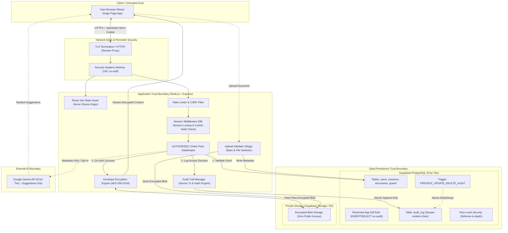
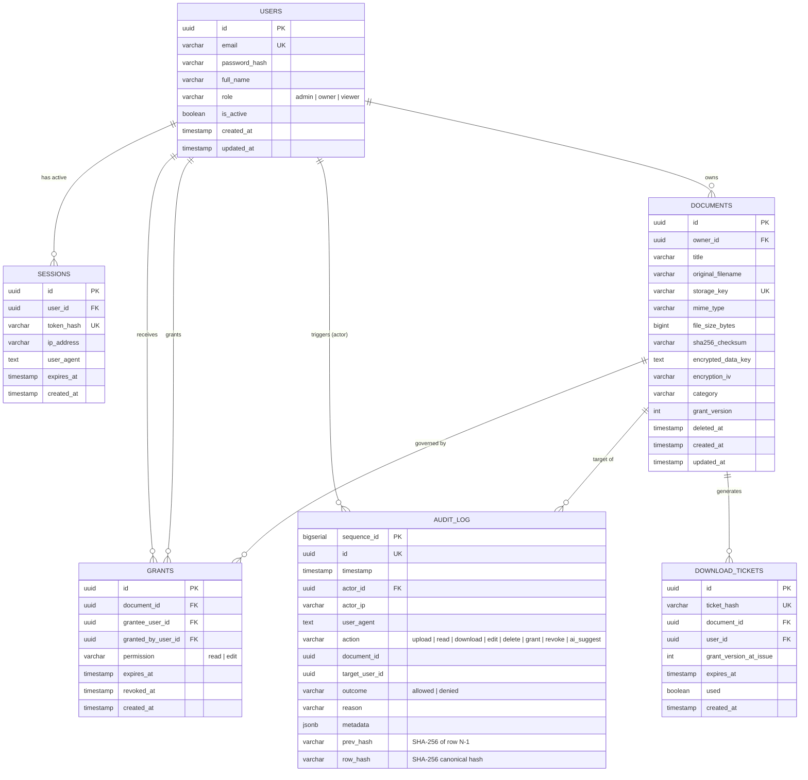
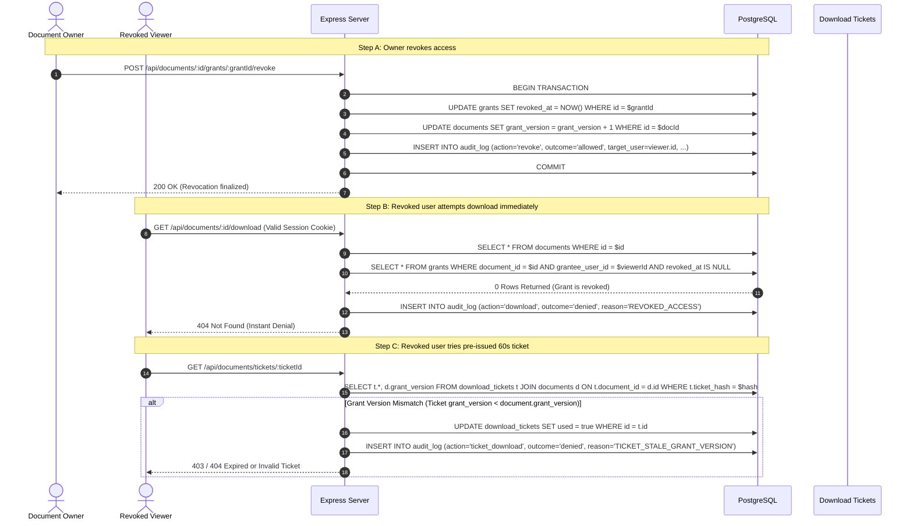
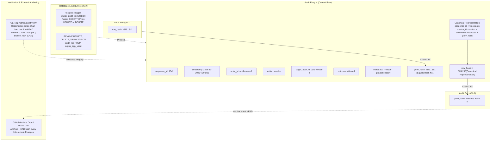
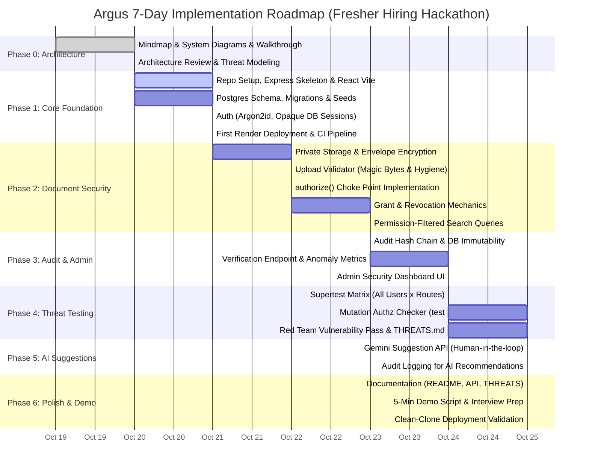

# Argus: System Architecture & Security Design

> **Argus (Audit, Revoke, Grant, Unified Security)**  
> *Snovasys Fresher Hiring Challenge 2026*  
> Document platform where the wrong person can never read a file, and every access—allowed or denied—is provably auditable and tamper-evident.

---

## 1. System Mind Map

```mermaid
mindmap
  root((Argus))
    Users & Roles
      Admin (Metadata & Audit only, No direct file access)
      Document Owner (Upload, Manage, Grant, Revoke, Delete)
      Viewer (Read/Edit only on granted documents)
      Disabled User (Instant session termination)
    Auth & Sessions
      Argon2id Password Hashing
      Server-side Opaque DB Sessions (SHA-256 token hash)
      HttpOnly Secure SameSite=Strict Cookies
      No Long-Lived JWTs
      Log Out Everywhere & Instant Kill
      CSRF Protection & Rate Limiting
    Documents
      Metadata (Title, Category, Tags, MIME, Size, Hash)
      Sanitised Filename on Download
      UUID Storage Keys (No predictable paths)
      Soft-Delete & Retention
    Storage
      Private Supabase / Cloudflare R2 Bucket
      Zero Public URLs
      Backend Streams File via authorize()
      Envelope Encryption (AES-256-GCM per-file key)
    Permission Model
      Per-Document Named Grants (read, edit)
      Single Choke Point: authorize(user, doc, action)
      Default Deny
      Return 404 on Unauthorized (Prevent IDOR / Existence Leaks)
      SQL-Filtered Search & Listings (INNER JOIN grants)
      Postgres Row Level Security (Defense-in-depth)
    Revocation
      Immediate Effect (No cache / No stale JWTs)
      Live DB Query per Request
      Short-Lived (<=60s) Single-Use Download Tickets
      Tickets bound to Grant Version
    Audit Trail
      Tamper-Evident Hash Chain (prev_hash, row_hash)
      Denied Attempts Recorded with Reason
      DB Trigger: UPDATE & DELETE Prohibited
      App Role: INSERT and SELECT Only
      Verification Endpoint (/api/admin/audit/verify)
      Atomic Writes (Action fails if audit fails)
      External Anchor (Periodic head hash publication)
    Search
      Filtered in SQL (Join on grants)
      Filters: Name, Owner, Category, Date
      Zero Leakage of Unauthorized Titles
    Upload Validation
      Strict MIME & Magic-Byte Sniffing
      Extension & Double-Extension Sanitization
      Zip Bomb & Macro Office Rejection
      Size Limit (10MB) & Rate Limiting
      SHA-256 Checksum Stored
    Admin Dashboard
      Audit Chain Integrity Check (Green / Red)
      Denied Access Heatmap / Anomaly Detection
      Permission Change Stream
      Bulk Download Alerts & Off-Hours Access
      Dormant Account & Expiring Grant Audits
    AI Suggestions
      Google Gemini API (Free Tier)
      Human-in-the-Loop Only (Never auto-grants)
      Metadata Only Input (Title, Category, Depts)
      Prompt Injection Hardening (UUID validation)
      Audit: Suggestion Made & Human Decision Recorded
    Testing & QA
      Supertest + Real Postgres Matrix
      Every Endpoint x Every User Role
      Threats-to-Tests 1:1 Mapping
      Mutation Check Script (patch authorize -> tests fail)
      Route Inventory Auth Coverage Verification
    Threats & Security
      THREATS.md Matrix
      Default Deny Architecture
      Secure Headers (CSP, HSTS, no-sniff, frame-ancestors none)
      No Secrets in Repo
    Deployment
      Render Free Web Service (Single-origin Express + React)
      Supabase Free Postgres & Private Storage
      GitHub Actions CI (Lint, Test, Audit verification)
    Docs & Demo
      API.md (RBAC & Authz per endpoint)
      5-Minute Video Demo Script
      Interview Prep (Choke point walkthrough)
      PROMPTS.md (Honest critique log)
```

### Walkthrough: "Explain it like I'm presenting to a judge"
> "Judges, Argus is engineered around three unbreakable pillars: **Strict Server-Side Authorization**, **Instant Revocation**, and a **Cryptographic Audit Trail**. Rather than scattering checks across frontend pages or routing controllers, every operation routes through an invariant gatekeeper: `authorize()`. Admins cannot snoop on confidential files because role permissions adhere strictly to least-privilege—administering the platform does not confer blanket read rights over user documents. Everything from upload validation with file magic bytes to envelope encryption at rest and single-origin cookie sessions exists to eliminate entire vulnerability classes (IDOR, session hijacking, poisoned file storage, and data leaks) on a completely free-tier infrastructure."

---

## 2. System Architecture & Trust Boundaries



### Walkthrough: "Explain it like I'm presenting to a judge"
> "Notice the clear separation of trust boundaries. The browser is completely untrusted; it receives no public storage URLs and no long-lived client tokens. Express serves both the built React assets and the API on the exact same origin, which eliminates cross-origin security flaws and allows strict `SameSite=Strict, HttpOnly` cookies. Within our application layer, no route can talk directly to storage or return file bytes without passing the `authorize()` choke point. Even inside the database boundary, we operate under defense-in-depth: the application database user has rights revoked for `UPDATE` and `DELETE` on the audit log, reinforced by an unbypassable PostgreSQL trigger that raises exceptions on alteration."

---

## 3. Request Flow Sequence: Document Download & Single Choke Point

```mermaid
sequenceDiagram
    autonumber
    actor User as Client Browser
    participant API as Express Router (/api/documents/:id/download)
    participant Session as SessionMiddleware
    participant Choke as authorize(user, doc, 'read')
    participant DB as PostgreSQL
    participant Audit as AuditLogger
    participant Storage as Private Bucket (Supabase Storage)
    participant Decrypt as Envelope Decryption (AES-256-GCM)

    User->>API: GET /api/documents/7f2a.../download (Session Cookie)
    API->>Session: Extract and hash session token
    Session->>DB: SELECT user, session WHERE token_hash = $1 AND expires_at > NOW()
    
    alt Session Invalid or User Disabled
        Session-->>User: 401 Unauthorized (Redirect to Login)
    else Session Valid
        Session->>API: Attach req.user (id, role, status)
    end

    API->>Choke: authorize(req.user, document_id, 'read')
    Choke->>DB: SELECT * FROM documents WHERE id = $1 AND deleted_at IS NULL
    
    alt Document Does Not Exist OR Soft-Deleted
        Choke->>Audit: record(actor=user.id, action='download', outcome='denied', reason='NOT_FOUND')
        Audit->>DB: INSERT INTO audit_log (...)
        Choke-->>User: 404 Not Found (Prevents IDOR existence leaks)
    else Document Exists
        Choke->>DB: Check Owner OR Active Grant (grantee_user_id = $1 AND permission IN ('read','edit') AND revoked_at IS NULL)
        
        alt Grant Missing or Revoked
            Choke->>Audit: record(actor=user.id, action='download', outcome='denied', reason='ACCESS_REVOKED_OR_ABSENT')
            Audit->>DB: INSERT INTO audit_log (...)
            Choke-->>User: 404 Not Found (Uniform 404 prevents existence enumeration)
        else Access Allowed
            Choke->>Audit: record(actor=user.id, action='download', outcome='allowed', reason='VALID_GRANT')
            Audit->>DB: INSERT INTO audit_log (..., prev_hash, row_hash)
            Choke->>API: Authorized (Return document record + storage_key)
            
            API->>Storage: Fetch encrypted stream (storage_key) with Server Service Key
            Storage-->>API: Encrypted stream bytes
            API->>Decrypt: Decrypt stream (Wrapped File Key via Master Key)
            API-->>User: 200 OK (Stream file with Content-Disposition: attachment; nosniff)
        end
    end
```

### Walkthrough: "Explain it like I'm presenting to a judge"
> "Here is our exact choke-point implementation for document downloads. First, authentication verifies the opaque session in Postgres. Second, `authorize()` performs the permission check. If someone attempts to access an unauthorized document ID, we intentionally return a **404 Not Found** instead of a 403 Forbidden. This prevents malicious actors from brute-forcing UUIDs to confirm whether sensitive documents exist. Crucially, even though the attacker receives a generic 404, the server **still writes a 'denied' audit record** with the actor's ID, IP, and timestamp. The file is never downloaded directly from storage; it is streamed through our backend after on-the-fly envelope decryption."

---

## 4. Permission Model & Entity-Relationship Diagram



### Walkthrough: "Explain it like I'm presenting to a judge"
> "The data model is deliberately normalized and defensive. Notice `grant_version` on the `DOCUMENTS` table: whenever an owner revokes or alters a grant, this version counter increments. Any short-lived download ticket issued even a few seconds earlier becomes immediately invalid because its embedded `grant_version_at_issue` no longer matches the document's current version. Notice also that the `AUDIT_LOG` stores both `prev_hash` and `row_hash`, forming a verifiable cryptographic blockchain inside Postgres."

---

## 5. Immediate Revocation Sequence



### Walkthrough: "Explain it like I'm presenting to a judge"
> "One of the most dangerous vulnerabilities in modern document systems is stale access—where a user's rights are revoked in the UI, but their active JWT or pre-signed AWS URL continues to work for 15 minutes. In Argus, we solve this in two ways:
> 1. **Zero cached authorization**: every document request runs an indexed lookup against Postgres to verify that `revoked_at IS NULL`.
> 2. **Versioned download tickets**: if an owner revokes access while a user is holding a 60-second download ticket, the document's `grant_version` increments in the same transaction. When the ticket is presented, the server verifies `ticket.grant_version == document.grant_version`. The check fails instantly."

---

## 6. Audit Trail Hash Chain & Immutability Architecture



### Walkthrough: "Explain it like I'm presenting to a judge"
> "If an attacker or malicious DBA compromises the application server, how do we stop them from secretly altering the audit logs to cover their tracks? We use four overlapping safeguards:
> 1. **Cryptographic hash chain**: each log row includes the SHA-256 hash of the previous row. Changing a single character, deleting a row, or reordering rows breaks the chain for every subsequent entry.
> 2. **Database role privileges**: the application user has only `INSERT` and `SELECT` granted. `UPDATE`, `DELETE`, and `TRUNCATE` are revoked at the SQL grant level.
> 3. **Immutability trigger**: an unbypassable PostgreSQL trigger aborts any modification attempts.
> 4. **External anchoring & verification**: `/api/admin/audit/verify` walks the entire chain in O(N) time. To defend against a Supabase superuser modifying the DB and recomputing the hashes, the head hash is periodically published externally (e.g., via GitHub Actions to a public commit or gist)."

---

## 7. Production Deployment Architecture (100% Free Tier)

```mermaid
flowchart LR
    subgraph ClientEnv ["User Environment"]
        UserDevice["Desktop / Mobile Browser"]
    end

    subgraph RenderFree ["Render.com (Free Web Service)"]
        direction TB
        NodeServer["Node.js + Express Server (Port 10000)"]
        ReactApp["Pre-built React + Vite SPA (Served as Static Middleware)"]
        EnvConfig["Environment Config:\nMASTER_ENCRYPTION_KEY\nDATABASE_URL\nSUPABASE_SERVICE_ROLE_KEY\nSESSION_SECRET\nGEMINI_API_KEY"]
    end

    subgraph SupabaseFree ["Supabase Cloud (Free Tier)"]
        direction TB
        PostgresDB[("PostgreSQL 15 Database\n- Users & Sessions\n- Documents & Grants\n- Tamper-Evident Audit Log")]
        SupabaseStorage[("Supabase Private Storage Bucket\n- Envelope-encrypted document blobs\n- No public read access")]
    end

    subgraph GoogleAI ["Google AI Studio"]
        GeminiAPI["Gemini 1.5 Flash API (Free Tier Tier / 15 RPM)"]
    end

    subgraph GitHubEco ["GitHub Ecosystem"]
        GHActions["GitHub Actions CI/CD\n- Vitest Suite\n- Mutation Authz Test\n- Route Inventory Check"]
        GitRepo["GitHub Public Repository (Commit History)"]
    end

    UserDevice <-->|HTTPS (Single Origin)| NodeServer
    NodeServer --- ReactApp
    NodeServer <-->|TLS Connection Pool| PostgresDB
    NodeServer <-->|Encrypted Blob API (Service Key)| SupabaseStorage
    NodeServer <-->|HTTPS REST| GeminiAPI
    GitRepo -->|Auto-Deploy on Push| RenderFree
    GitRepo -->|Trigger CI on Push| GHActions
```

### Walkthrough: "Explain it like I'm presenting to a judge"
> "Argus runs entirely within production-grade free tiers with zero credit cards required. Express serves the pre-built React frontend from the static directory, ensuring single-origin deployment with zero CORS headaches and secure HTTP-only cookies. File storage is kept in a private Supabase bucket that completely forbids public requests; only our Render backend can talk to storage using the service role key. Database transactions leverage Postgres on Supabase, and Google Gemini 1.5 Flash provides intelligent permission suggestions with zero cost."

---

## 8. 7-Day Implementation Roadmap (Oct 19–25, 2026)



### Walkthrough: "Explain it like I'm presenting to a judge"
> "Notice our cadence: we deploy a working skeleton to Render on Day 2. We never leave deployment to the final hour. The core security primitives—choke point authorization, upload validation, immediate revocation, and audit hash chains—are complete and tested by Day 4. The remaining days are devoted to rigorous automated testing, mutation tests to prove our test suite fails if security checks are bypassed, AI integration with strict human approval, and complete documentation."
